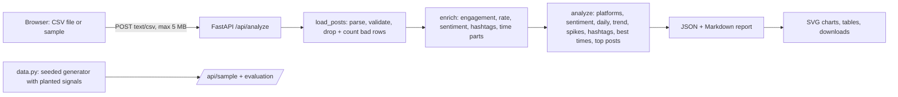

# Architecture

Author: Rayyan Anwar

## Flow
1. The browser reads the CSV and posts the text. The server never stores it.
2. `load_posts` normalises headers, parses timestamps (ISO fast path, element-wise fallback for other formats), coerces counts, drops invalid rows and duplicate `post_id`s, and reports exactly how many of each.
3. `analyze` computes everything with pandas; results are made JSON-safe (NaN becomes null).
4. The UI draws charts as inline SVG and offers JSON, Markdown and daily-CSV downloads.

## Method notes
- Engagement = likes + shares + comments. Engagement rate = engagement / followers when followers > 0.
- Trend: linear slope of daily engagement plus Spearman correlation with time; labelled increasing/decreasing only if |rho| > 0.3 and the relative slope exceeds 0.5% per day.
- Spikes: robust z-score (median and MAD, falling back to standard deviation when MAD is 0), threshold 3.5.
- Best times: mean engagement per hour/weekday, only for slots with at least max(5, 1% of posts) posts.
